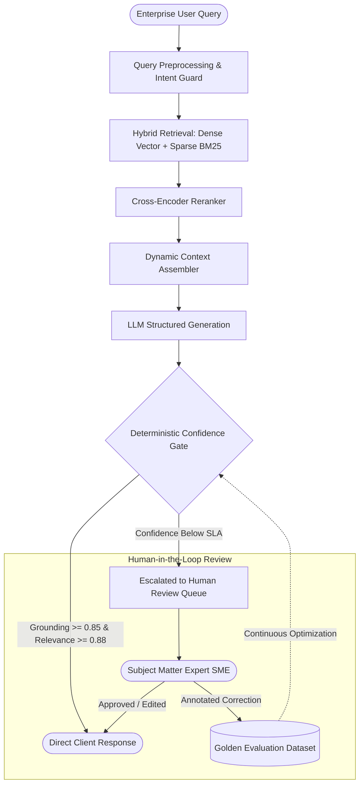

# Human-in-the-Loop (HITL) RAG Orchestrator

Production-ready Retrieval-Augmented Generation (RAG) architecture engineered for mission-critical enterprise domains (legal, medical, financial) where hallucination rates must be deterministically bounded through human SME review fallbacks.

---

## Architectural Workflow



---

## Core Engineering Patterns

- **Hybrid Retrieval Strategy**: Combines dense semantic embeddings (vector search) with sparse exact-match algorithms (BM25) to prevent terminology misses on domain-specific acronyms and part numbers.
- **Cross-Encoder Re-Ranking**: Reranks top 50 candidates down to top 5 context chunks, cutting token overhead and latency while elevating signal-to-noise ratio.
- **Dual-Metric Guardrails**: Evaluates both **Grounding** (source attribution check) and **Relevance** (semantic response accuracy) prior to response delivery.
- **Continuous Feedback Flywheel**: SME edits from flagged outputs are automatically formatted as structured feedback records to continuously enrich regression test suites and model evaluation runs.

---

## Repository Structure

```text
├── docker-compose.yml              # Qdrant Vector DB & Orchestrator local setup
├── contracts/
│   └── evaluation_contract.json    # JSON Schema for routing & confidence scores
├── src/
│   ├── guards/
│   │   └── confidence_gate.py      # Threshold evaluation & escalation logic
│   ├── retrieval/                  # Dense & BM25 hybrid querying interfaces
│   └── orchestration/              # Request lifecycle & SME dispatcher
└── README.md
```

---

## Running the Mock Stack

```bash
docker compose up -d
```